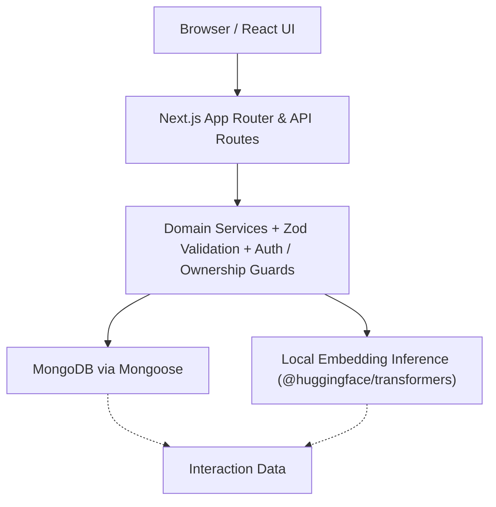

# FindYourPeace — Technology Stack & Architecture

> **Document:** Project Documentation  
> **Prepared:** 10 October 2026  
> **Baseline:** Latest available project reports and current recorded product decisions.  
> **Subtitle:** Current full-stack architecture and AI/ML boundaries  

---

## 1. Architecture overview

```text
Browser / React UI
   | Next.js App Router and API routes
   v
Domain services + Zod validation + auth / ownership guards
   |                         |
   v                         v
MongoDB via Mongoose     Local embedding inference
   |                         |
   +---- interaction data ---+
```



The current application is a Next.js full-stack system. Standard business workflows remain in Next.js routes/services. MongoDB is the persistent store. Local embeddings support semantic search; Python/FastAPI is a future option only if justified.

---

## 2. Core stack

| Layer | Technology | Responsibility |
|---|---|---|
| **Framework** | Next.js 16.4 App Router | Routing, rendering, API endpoints. |
| **UI runtime** | React 19.3 + TypeScript | Typed components and interactions. |
| **Styling** | Tailwind CSS v4 | Responsive layout and theme tokens. |
| **Motion/primitives** | Framer Motion 14; Radix UI | Intentional motion and accessible primitives. |
| **Forms** | React Hook Form + Zod v4 | Form state and validation. |
| **Database** | MongoDB + Mongoose 9.11 | Domain records, indexes, inventory. |
| **Auth** | jose + bcryptjs | Signed session token in HttpOnly cookie; password hashing. |
| **AI search** | @huggingface/transformers; all-MiniLM-L6-v2 | Local 384-dimensional embeddings and cosine similarity. |
| **Validation** | tsx tests, ESLint, Next build | Focused tests, lint and production compilation. |

---

## 3. Security rules

- `staynest_session` cookie: HttpOnly, SameSite=Lax, Secure in production; current notes indicate seven-day max age.
- Password hashes excluded from ordinary user queries.
- Every mutation performs server-side role and resource ownership checks.
- Never store session tokens or secrets in browser storage or expose environment values.
- `searchId` is generated on the server; client-supplied values are not authoritative.

---

## 4. AI/ML boundaries

| Capability | Boundary |
|---|---|
| **Intent parsing** | TypeScript service with structured validation. |
| **Candidate retrieval** | Hard constraints in Next.js/MongoDB services. |
| **Embeddings** | Local Transformers model, 384 dimensions. |
| **Hybrid ranking** | Current 70% deterministic + 30% semantic; not proven optimal by small benchmark. |
| **FastAPI** | Future only for separate model-serving or compute needs. |
| **MLOps** | Deferred until there is a real trained/deployed model lifecycle. |

---

## 5. Indexing notes

- Reported unique indexes: user email, property slug, bookingCode, and `{room, date}` inventory.
- Property has a `2dsphere` location index and text index over title/locality/description per QA report.
- `UserInteraction.searchId` is optional and indexed, not unique.
- Verify exact installed versions and indexes against current files before release.

---

## 6. Engineering rules

- Inspect with Serena symbol-first workflow; use Context7 only for a concrete API/documentation question.
- Reuse existing services/models/components; avoid duplicate files.
- Keep changes phase-scoped and test changed code first.
- Do not change ranking weights without adequate evaluation evidence.
- Current UI roles are `renter` and `host`; internal host role string is `owner`.

---

## 7. Known caveat

Versions and lint status are based on the latest available project reports, not a fresh repository inspection. A previous repo-wide lint run reported two unrelated legacy UI errors; Priority 1 changed-file lint passed.

---

## Extraction Note

- **Source PDF:** `02_StayNest_Tech_Stack.pdf`
- **Extraction Date:** 2026-10-11
- **Page Count:** 3 pages
- **Extraction Scope & Limitations:** Complete text, architecture flows, tables, and rules extracted without omission.
