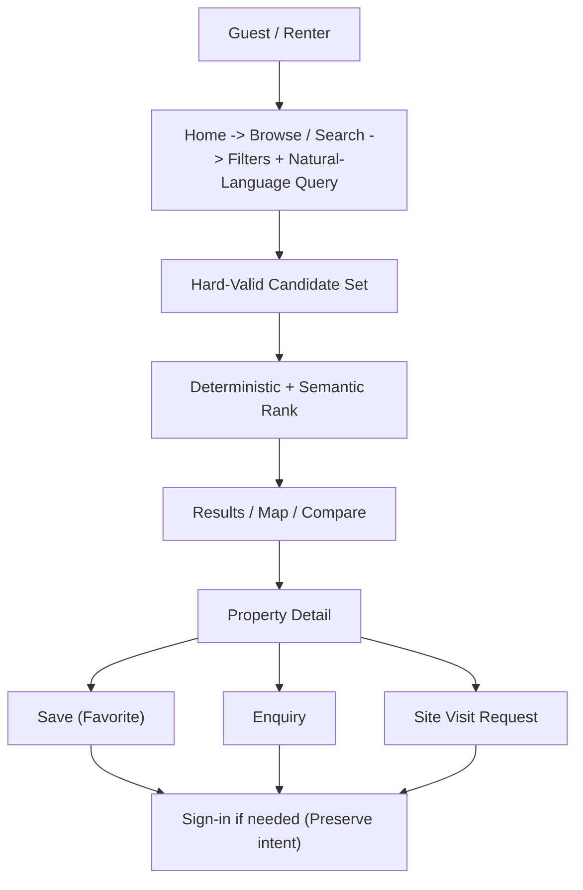
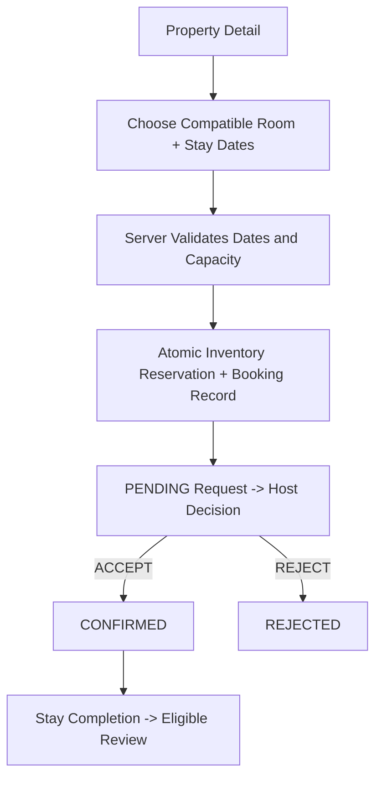
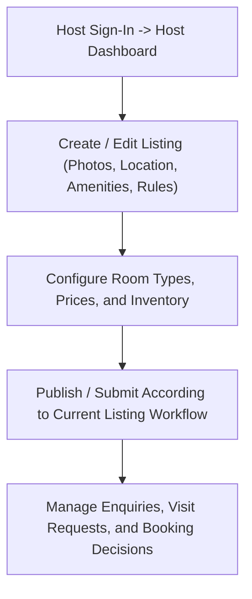
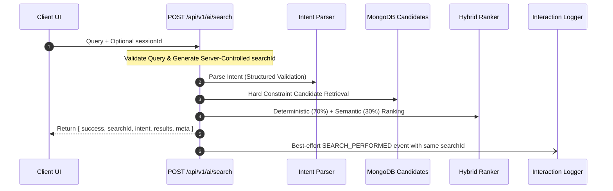

# FindYourPeace — Application Flow & User Journeys

> **Document:** Project Documentation  
> **Prepared:** 10 October 2026  
> **Baseline:** Latest available project reports and current recorded product decisions.  
> **Subtitle:** Public discovery, renter actions, host operations, and AI search  

---

## 1. Public discovery flow

```text
Guest / Renter
    |
    v
Home -> Browse / Search -> Filters + natural-language query
                                  |
                                  v
                    Hard-valid candidate set
                                  |
                                  v
                   Deterministic + semantic rank
                                  |
                                  v
                     Results / Map / Compare
                                  |
                                  v
                          Property detail
                       /       |        \
                    Save    Enquiry    Site visit
                       \       |        /
                         Sign-in if needed
```



---

## 2. Renter booking flow

```text
Property detail
   -> Choose compatible room + dates
   -> Server validates dates and capacity
   -> Atomic inventory reservation + booking record
   -> PENDING request -> Host decision
                         /          \
                    ACCEPT          REJECT
                      |                |
                 CONFIRMED          REJECTED
                      |
                Stay completion -> eligible review
```



> **Note:** A booking request is not an instant confirmation. V1 has no payment gateway.

---

## 3. Host flow

```text
Host sign-in -> Host dashboard
  -> Create/edit listing -> photos, location, amenities, rules
  -> Configure room types, prices and inventory
  -> Publish/submit according to current listing workflow
  -> Manage enquiries, visit requests and booking decisions
```



---

## 4. Auth and authorization

- Guests can browse public pages without an account.
- Renter-only actions require authentication and should preserve intended action where supported.
- Host routes and mutations require host role plus server-side ownership checks.
- Renter and host navigation must remain separate; renter shell must not contain host promotions.

---

## 5. AI search request flow

```text
POST /api/v1/ai/search
  -> validate query + optional sessionId
  -> generate server-controlled searchId
  -> parse intent -> hard candidate retrieval
  -> deterministic + semantic ranking
  -> return { success, searchId, intent, results, meta }
  -> best-effort SEARCH_PERFORMED event with same searchId
```



Priority 1 adds the search execution ID. Passing it into property views, saves, enquiries, visits, and bookings is separate follow-up scope and is not assumed complete.

---

## 6. Error and empty states

- **No matches:** explain constraints and allow easy edits.
- **Embedding unavailable:** search remains available with deterministic fallback.
- **Invalid dates or full inventory:** clear server validation response; never silently overbook.
- **Loading/empty/error states:** should reflect real content and never fabricate activity.

---

## 7. Core journey tests

- Guest searches and opens a property.
- Renter saves after login.
- Renter requests a visit and host responds.
- Booking request transitions PENDING to host decision without overbooking.
- Host cannot mutate another host's property.
- AI search returns the exact ID recorded on SEARCH_PERFORMED.

---

## Extraction Note

- **Source PDF:** `03_StayNest_App_Flow.pdf`
- **Extraction Date:** 2026-10-11
- **Page Count:** 3 pages
- **Extraction Scope & Limitations:** Complete text, journey diagrams, decision trees, and journey tests extracted without omission.
