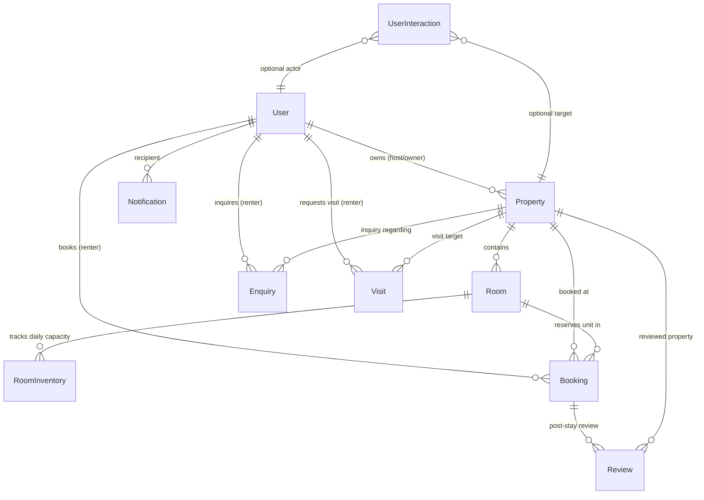

# FindYourPeace — Backend Schema & Data Integrity

> **Document:** Project Documentation  
> **Prepared:** 10 October 2026  
> **Baseline:** Latest available project reports and current recorded product decisions.  
> **Subtitle:** Logical MongoDB/Mongoose model and relationship reference  

**Notice:** Logical schema reference only. Verify exact field definitions against current model files before schema changes.

---

## 1. Accuracy boundary

This is an implementation-informed logical schema, not a generated dump of current Mongoose definitions. Verify exact field names, enums, optionality, and indexes in the current repository before using it as a migration specification.

---

## 2. Relationships

```text
User (renter or owner) 1:N Property
Property 1:N Room
Room 1:N RoomInventory (one record per room/date)
Booking references renter + property + room + stay dates
Enquiry references renter + property/host
Visit references renter + property/host
Review references booking + property + renter
Notification references recipient and event context
UserInteraction records user/session behavior
Property.descriptionVector stores semantic embedding
```



---

## 3. Entity overview

| Model | Purpose | Known fields / constraints |
|---|---|---|
| **User** | Account and role | `name`, `email`, `passwordHash`, `role=renter\|owner`; unique `email`; `passwordHash` excluded from normal queries. |
| **Property** | Listing/search document | `owner` ref, `title`, `slug`, `description`, `city`/`locality`/`address`, `type`, `preferredFor`, `amenities`, `food`/`security`/`rules`, `status`, `rating`/`reviewCount`, `location`, `descriptionVector`, `aiSummary`; unique `slug`; text/geospatial indexes reported. |
| **Room** | Bookable room type/unit | `property` ref, `occupancy`/`type`, `price`, `inventory`/`capacity`, `status`/`availability`, `amenities`; ownership checked through parent property. |
| **RoomInventory** | Date-level capacity ledger | `room` + `date` unique pair; atomic capacity/reservation fields; prevents concurrent overbooking. |
| **Booking** | Request and stay lifecycle | `renter`, `property`, `room`, `bookingCode`, `check-in`/`out`, `status`; unique `bookingCode`; date inventory is reserved/released atomically. |
| **Enquiry** | Renter-host conversation | `renter`, `property`, `message`/`thread`, status and response fields; participant/ownership checks. |
| **Visit** | Site-visit request | `renter`, `property`, requested `date`/`time`, `mode`, status and host response/reschedule fields. |
| **Review** | Post-stay trust signal | `booking`, `property`, `renter`, `rating` and `text`; unique `booking` index reported. |
| **Notification** | In-app event | `recipient`, `event`/`type`, read state, `payload`/`reference` and timestamps. |
| **UserInteraction** | Behavioral event stream | `eventType`, optional `user`/`session`/`property`, `searchCriteria`, `metadata`, `timestamp`; optional indexed `searchId` after Priority 1. |

---

## 4. Integrity rules

- Reported unique constraints: email, property slug, bookingCode, and `{room, date}` inventory.
- Check room capacity per requested date; do not decrement total capacity permanently for every booking.
- If a multi-night reservation fails part-way, roll back inventory reserved earlier in the attempt.
- Every host mutation verifies authenticated host owns the parent property.
- Review eligibility depends on a valid completed/confirmed stay per current product rules.
- `searchId` is server-generated for each AI search, returned and stored on `SEARCH_PERFORMED`; its index is non-unique.
- Interaction logging must not break search or booking workflows.

---

## 5. Search event (conceptual)

```text
SEARCH_PERFORMED
- eventType: SEARCH_PERFORMED
- searchId: srch_<uuid> (optional for legacy records)
- user: optional authenticated user reference
- sessionId: optional session reference
- searchCriteria: query text + structured intent
- metadata: candidate count and current ranking summary
- timestamp: event time
```

> **Attribution Note:** Priority 1 does not yet propagate `searchId` to property views, saves, enquiries, visits, or bookings. Do not infer search attribution from temporal proximity alone.

---

## 6. Index strategy

- Unique indexes reported for `email`, `slug`, `bookingCode`, and `{room, date}`.
- Property location uses `2dsphere`; title/locality/description have text search index per QA report.
- `UserInteraction.searchId` uses a non-unique index.
- Add indexes based on observed query patterns and verify against current schema.

---

## 7. Privacy and role notes

- Never store plaintext passwords, JWT secrets, session tokens, or payment credentials.
- Free-text queries may contain personal information; minimize retention and unnecessary logging.
- Do not trust client-supplied search IDs as proof of attribution.
- Current UI roles are `renter` and `host` (internal role string `owner`); older admin architecture references are stale.

---

## Extraction Note

- **Source PDF:** `05_StayNest_Backend_Schema.pdf`
- **Extraction Date:** 2026-10-11
- **Page Count:** 3 pages
- **Extraction Scope & Limitations:** Complete text, entity models, ER relationships, integrity rules, index strategy, and event schemas extracted without omission.
