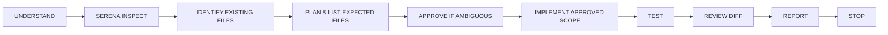

# FindYourPeace — Implementation Plan & Delivery Gates

> **Document:** Project Documentation  
> **Prepared:** 10 October 2026  
> **Baseline:** Latest available project reports and current recorded product decisions.  
> **Subtitle:** Controlled phases, visual cleanup, testing, and AI/ML roadmap  

---

## 1. Engineering principles

- Inspect before editing; use Serena symbol-first workflow.
- Reuse existing files, models, services, validators, and components.
- Keep every change tightly scoped to approved work.
- Run focused tests, relevant regression tests, changed-file lint, diff review, and production build.
- Do not tune ranking weights without evaluation evidence.
- Use Context7 only for a concrete documentation question.

---

## 2. Current baseline

| Area | Known status | Guardrail |
|---|---|---|
| **Marketplace/auth** | Renter/host workflows and server-side checks reported implemented. | Verify current code before changes. |
| **Database/booking** | Ten Mongoose domain models reported; RoomInventory and atomic capacity logic implemented. | Preserve concurrency guarantees. |
| **AI search** | Intent, hard retrieval, deterministic rank, local embeddings and hybrid rank. | Keep hard constraints authoritative. |
| **Hybrid ranking** | 70% deterministic / 30% semantic. | No tuning from small benchmark. |
| **Phase 3A Priority 1** | Closed: server-generated searchId persisted and returned. | Do not rewrite without concrete issue. |
| **Lint** | Focused lint passed; two unrelated legacy errors reported repo-wide. | Track separately. |

---

## 3. Recommended work sequence

| Stage | Scope | Acceptance gate |
|---|---|---|
| **A. Visual cleanup** | Audit current UI; remove generic AI-template patterns; no-blue warm pastel/charcoal theme. | Screenshots in both modes; accessibility and build pass. |
| **B. Phase 3A Priority 2** | Propagate searchId to property view/save interactions. | Validate search exists and property belonged to that result set; tests pass. |
| **C. Priority 3** | Attribute enquiries, visits and booking conversions. | Backward-compatible optional fields; forged attribution rejected. |
| **D. Priority 4** | Persist bounded ordered candidate/ranking snapshots if approved. | Stable ordering, privacy review, regression tests. |
| **E. Data analysis** | Analyze funnels after attribution is reliable. | Distinguish correlation from causation. |
| **F. Evaluation expansion** | Use more candidate diversity and independent relevance labels. | Adequate data before changing weights. |
| **G. Future AI features** | Description assistance/recommendations if useful; FastAPI/MLOps only if justified. | Fallback, privacy, evaluation, latency/cost budgets. |

---

## 4. Immediate visual cleanup work package

- Inventory pages and shared components before editing; identify repeated template patterns.
- Search tokens and components for blue, navy, indigo, cyan and blue-grey values.
- Use ivory/cream, terracotta, sage, blush, butter, lavender and warm neutrals in light mode.
- Use near-black, charcoal, graphite and neutral grey in dark mode.
- Remove gradient blobs, neon glows, gradient text, sparkle icons, repeated generic icon cards, fake metrics and unnecessary floating effects.
- Preserve actual content, property imagery, search, auth, dashboards and booking flows.
- Prefer editorial composition, real property photos and purposeful motion.
- Capture before/after screenshots; validate mobile, keyboard, contrast, reduced motion and build.

---

## 5. Test strategy

- **Unit tests:** intent parsing, hard constraints, deterministic ranking, embedding fallback, interaction persistence.
- **API tests:** auth, role checks, ownership/IDOR, validation, status transitions, searchId authority.
- **Inventory tests:** overlapping dates, partial rollback, cancellation release, concurrent requests.
- **Visual tests:** no-blue audit, both themes, responsive layout, reduced motion, loading/empty/error states.
- Report exact commands and exit codes; never claim an uncompleted test passed.

---

## 6. Change-control workflow

```text
UNDERSTAND -> SERENA INSPECT -> IDENTIFY EXISTING FILES
-> PLAN AND LIST EXPECTED FILES -> APPROVE IF AMBIGUOUS
-> IMPLEMENT APPROVED SCOPE -> TEST -> REVIEW DIFF
-> REPORT -> STOP
```



---

## 7. Definition of done

- Only intended files changed; preserve pre-existing working-tree changes.
- No unnecessary dependencies or duplicate helpers.
- Security, compatibility and functional regression tests pass.
- Design follows the no-blue and anti-AI-template rules in both themes.
- Production build succeeds; unrelated lint failures documented separately.
- Final report lists files, tests, build outcome, risks and deferred items.

---

## 8. Deferred

- SearchId propagation beyond Priority 1 until next phase approval.
- Automatic ranking tuning and personalization until behavioral data is reliable.
- Vector database until volume/latency justify it.
- FastAPI/MLOps until there is a real model-serving/training requirement.
- Payments until separately scoped.

---

## Extraction Note

- **Source PDF:** `06_StayNest_Implementation_Plan.pdf`
- **Extraction Date:** 2026-10-11
- **Page Count:** 3 pages
- **Extraction Scope & Limitations:** Complete text, baseline tables, work sequence gates, test strategy, workflow diagrams, definition of done, and deferred roadmaps extracted without omission.
